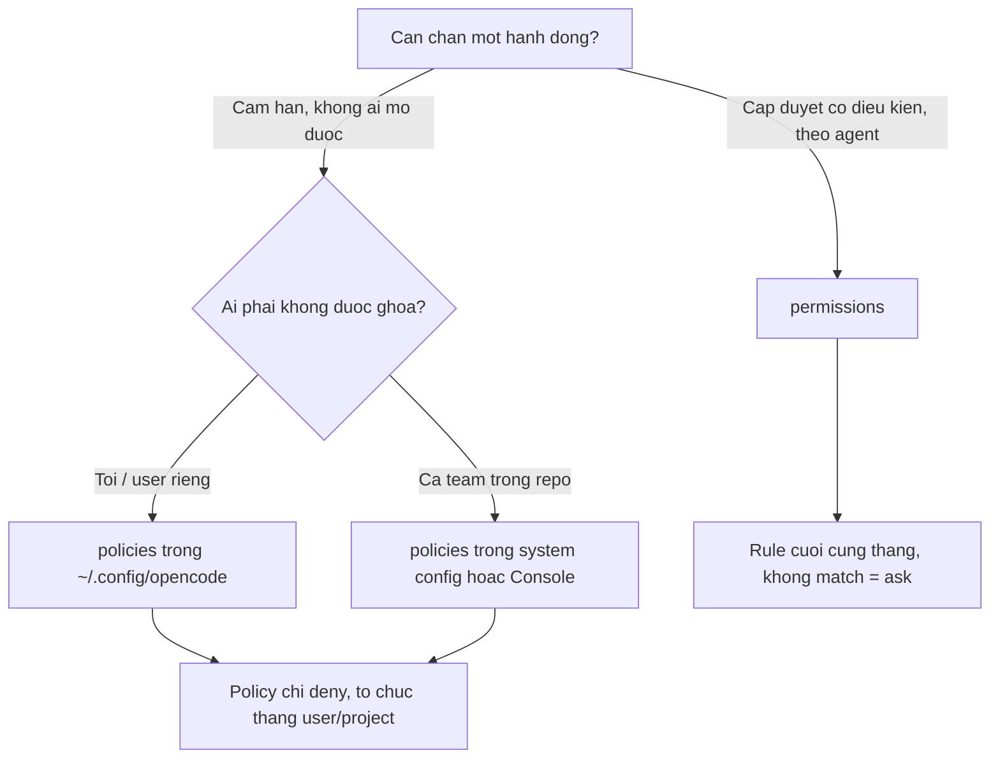

# FAQ 03 — Permissions & Policies

> Tra nhanh khi agent bị chặn (hoặc được phép quá tay). Link chéo: [Bài 09 — Permissions & Policies](../01-huong-dan-su-dung/09-permissions-policies.md), [FAQ 08](./08-bao-mat-faq.md), [Bài 10 — Background tasks](../01-huong-dan-su-dung/10-background-tasks.md).
> Nguồn chính thức: [permissions](https://opencode.ai/v2/docs/permissions) · [policies](https://opencode.ai/v2/docs/policies) (verify 28/10/2026, OpenCode 2.2.0).

## Q1: "Viết `allow` rồi sao vẫn bị chặn?"

**Trả lời 1 câu:** `policies deny` (org/system/Console) luôn thắng `permissions allow` lẫn saved approval "Allow always".

**Giải thích:** Thứ tự đánh giá: permissions + saved approvals chạy trước, policies chạy **sau** và chỉ có thể siết thêm — policy không bao giờ cấp quyền ([policies](https://opencode.ai/v2/docs/policies), verify 28/10/2026). Request bị chặn bởi policy sẽ báo `Blocked by configuration policy` thay vì hỏi bạn. Vì vậy nếu allow không chạy, nguyên nhân gần như luôn nằm ở tầng cao hơn: policy project (bị global/system/Console phủ), hoặc rule `deny` một chỗ khác match sau cùng.

**Làm thế nào:**

1. Đọc config theo thứ tự từ dưới lên: permissions của agent → permissions global → policies (project → global → system → Console — tầng rộng đánh giá sau).
2. Mở log server: `grep 'role=server' ~/.local/share/opencode/log/opencode.log`.
3. Tìm rule policy đang match resource của bạn.

```jsonc
// policy khien sudo luon bi chan, khong can ai bap Allow
{ "policies": [{ "action": "tool.use", "resource": "shell:sudo *", "effect": "deny" }] }
```

**Nếu vẫn lỗi:** hỏi admin org — project config **không** mở được khóa policy của org/Console; message "Blocked by ..." kèm tên workspace là do Console policy ([policies](https://opencode.ai/v2/docs/policies)).

## Q2: "Rule nào thắng khi nhiều rule cùng khớp?"

**Trả lời 1 câu:** Rule khớp **cuối cùng** trong mảng `permissions` thắng — viết từ rộng tới hẹp.

**Giải thích:** OpenCode ghép các rule theo thứ tự và lấy match cuối; rule từ global được **append trước** rule của agent nên agent refine được global, không ghi đè ([permissions](https://opencode.ai/v2/docs/permissions), verify 28/10/2026). Không rule nào match → mặc định `ask`. Một operation có thể kiểm tra nhiều resource (vd patch đụng 3 file): có bất kỳ `deny` nào → chặn; ngược lại có `ask` nào → hỏi; không thì cho qua.

```jsonc
// " *" cuoi pattern match ca lenh khong args
// "git status *" match ca "git status" lan "git status --short"
{ "permissions": [
  { "action": "shell", "resource": "*", "effect": "ask" },
  { "action": "shell", "resource": "git status *", "effect": "allow" }
] }
```

**Nếu vẫn lỗi:** hành vi khác kỳ vọng thì kiểm tra thứ tự — rule hẹp đặt **trước** rule rộng là lỗi kinh điển; nhớ wildcard `*` khớp cả `/` nên `*.env` không chặn được `secrets/api.key`.

## Q3: "`opencode run` non-interactive treo đợi approve?"

**Trả lời 1 câu:** Rule nào resolve thành `ask` thì không ai bấm Allow được — phải allow/deny sẵn trong config cho mọi thứ task cần, `deny` thì luôn được giữ.

**Giải thích:** Client non-interactive tự quyết định cách xử lý approval request; docs nhấn mạnh "configured `deny` rules always remain enforced" ([permissions](https://opencode.ai/v2/docs/permissions), verify 28/10/2026). Với automation, câu trả lời dễ nhất là không để xảy ra `ask`: allowlist những lệnh task cần, deny sẵn cái nguy hiểm.

**Làm thế nào:**

1. Chạy task một lần trong TUI, ghi lại các prompt permission xuất hiện.
2. Thêm rule `allow` cho phần an toàn, `deny` cho phần nguy hiểm vào config.
3. Chạy lại `opencode run` — không còn prompt là ổn.

```jsonc
{ "permissions": [
  { "action": "shell", "resource": "*", "effect": "deny" },
  { "action": "shell", "resource": "npm test *", "effect": "allow" },
  { "action": "shell", "resource": "git status *", "effect": "allow" }
] }
```

**Nếu vẫn lỗi:** vẫn bị hỏi → có resource nào bạn chưa bọc (vd `read` file ngoài project qua `external_directory`); hoặc dùng `session.permissions: "autoaccept"` trong `cli.json` nếu chấp nhận auto-accept mọi prompt ở TUI.

## Q4: "Khi nào dùng `permissions`, khi nào dùng `policies`?"

**Trả lời 1 câu:** permissions = luật hành vi theo agent (allow/deny/ask); policies = khóa cứng không thể bị project/user ghi đè.



**Giải thích:** Policies nhị phân (allow/deny), không prompt, chỉ tighten — và **đảo chiều precedence**: config rộng hơn được đánh giá sau nên thắng config hẹp; system file và Console luôn thắng project ([policies — Precedence](https://opencode.ai/v2/docs/policies), verify 28/10/2026). Đó là lý do "repo không thể mở lại provider mà org đã deny". Còn permissions là rule 3 trường (`action`/`resource`/`effect`) theo từng agent, có `ask`.

**Làm thế nào:**

1. Chặn tuyệt đối cho cả máy/team → `policies` ở system config (`/etc/opencode`, managed preferences) hoặc Console.
2. Quy tắc theo project/agent → `permissions` trong `opencode.jsonc` hoặc `agents.<id>.permissions`.
3. Cả hai có thể dùng cùng lúc — policy là "rào thép", permission là "nội quy hằng ngày".

**Nếu vẫn lỗi:** policy `tool.use` với `allow` không cấp quyền — nó chỉ gỡ `deny` rộng hơn trước đó, sau đó agent rule tự quyết.

## Q5: "Đọc `.env` / ra ngoài project — default mới là gì?"

**Trả lời 1 câu:** `.env` mặc định là `ask`, còn **ra ngoài project mặc định là cho phép** — khác v1, muốn bị hỏi thì phải tự thêm rule.

**Giải thích:** Base policy của mọi agent (kể cả custom): `allow` toàn bộ, rồi `read *.env` → `ask`, `read *.env.*` → `ask`, `read *.env.example` → `allow` ([permissions — Defaults](https://opencode.ai/v2/docs/permissions), verify 28/10/2026). Callout riêng cho `external_directory`: **v2 không hỏi** khi agent đọc/sửa ngoài location (v1 có hỏi) — đây là thay đổi hành vi dễ gây bất ngờ nhất khi migrate.

```jsonc
// giu hanh vi "hoi truoc khi ra khoi project" cua v1
{ "permissions": [
  { "action": "external_directory", "resource": "*", "effect": "ask" }
] }
```

**Nếu vẫn lỗi:** muốn cấm hẳn .env (không chỉ hỏi) → thêm `{ "action": "read", "resource": "*.env", "effect": "deny" }` **sau** các rule default (append sau = thắng).

## Q6: "Bấm 'Allow always' rồi làm sao rà lại những gì đã duyệt?"

**Trả lời 1 câu:** Saved approvals là rule `allow` bền, theo project — quét và dọn định kỳ vì một số tool đề xuất pattern rất rộng (như `*`).

**Giải thích:** Chọn **Allow always** khi được hỏi → OpenCode lưu pattern do tool đề xuất: shell đề xuất prefix lệnh, skill/subagent đề xuất ID của chúng, một số tool khác đề xuất `*` ([permissions — Approvals](https://opencode.ai/v2/docs/permissions), verify 28/10/2026). Saved approval không bao giờ thắng `deny` cấu hình sẵn, nhưng có thể phình to khó kiểm soát nếu bấm vì mệt. API có các endpoint để liệt kê/xóa: `GET /api/permission/saved`, `DELETE /api/permission/saved/{id}`.

**Làm thế nào:**

1. Liệt kê: `opencode api get /api/permission/saved`.
2. Tất cả là rule `allow` phạm vi project — sửa/xóa qua `PATCH`/`DELETE` cùng đường dẫn.
3. Không cần pattern nữa → xóa để quay về hỏi mỗi lần.

**Nếu vẫn lỗi:** thấy pattern `*` lạ lẫm — đó là dấu vết của lần bấm "Allow always" vội; xóa nó, thay bằng rule hẹp viết tay trong config.

## Q7: "Chặn một tool MCP / một skill mà không ngắt server?"

**Trả lời 1 câu:** Dùng permission action theo tên đã chuẩn hóa — `context7_*` chặn mọi tool của server context7, `skill` chặn theo skill ID.

**Giải thích:** Action của tool MCP là `<server>_<tool>` với ký tự lạ đổi thành `_`; resources cho MCP resource là `opencode_list_mcp_resources` / `opencode_read_mcp_resources` ([permissions — Actions](https://opencode.ai/v2/docs/permissions), [mcp-servers — Permissions](https://opencode.ai/v2/docs/mcp-servers), verify 28/10/2026). `deny` skill thì ẩn skill khỏi model và từ chối cả khi gọi tay.

```jsonc
// chan moi tool cua server context7, giu server van ket noi
{ "permissions": [
  { "action": "context7_*", "resource": "*", "effect": "deny" }
] }
```

**Làm thế nào:**

1. Xác định tên đã normalize của tool (`<server>_<tool>`).
2. Thêm rule `deny` theo prefix `<server>_*` hoặc đích danh từng tool.
3. Muốn chặn cả cụm Code Mode của server → deny action `execute`.

**Nếu vẫn lỗi:** tool vẫn chạy → nhớ last-match-wins: rule `allow` cụ thể nằm **sau** rule `deny` của bạn sẽ thắng.

## Q8: "Viết policy trong `opencode.json` project mà sao global vẫn thắng?"

**Trả lời 1 câu:** Policies đảo precedence — config rộng hơn (global/system/Console) được đánh giá **sau** nên thắng config hẹp (project).

**Giải thích:** Bảng precedence của policies: managed preferences > system config > Console workspace > global user > `opencode.json(c)` trực tiếp > `.opencode/opencode.json(c)` — trong đó outer directory thắng inner ([policies — Precedence](https://opencode.ai/v2/docs/policies), verify 28/10/2026). Vì vậy repo không thể "mở lại" provider mà org đã deny toàn cục. Trong cùng một file thì giữ nguyên thứ tự viết, rule cuối thắng.

**Làm thế nào:** cần luật cứng cho cả org → đưa vào system config hoặc Console policy; đừng kỳ vọng project `allow` kéo lại.

**Nếu vẫn lỗi:** policy statement sai validation sẽ bị **drop kèm warning trong server log** — check log trước khi kết luận policy chưa chạy; `experimental.policies` cũ vẫn merge vào `policies` nhưng đã deprecated.

## Q9: "Wildcards trong resource đọc thế nào?"

**Trả lời 1 câu:** `*` khớp zero hoặc nhiều ký tự **kể cả `/`**, `?` khớp đúng một ký tự, còn lại là ký tự literal — và path được normalize (backslash → slash, case-insensitive trên Windows).

**Giải thích:** "simple whole-value wildcards" ([permissions — Matching](https://opencode.ai/v2/docs/permissions), verify 28/10/2026). Vì `*` ăn cả `/`, một pattern như `packages/*` không giới hạn theo cấp thư mục như bạn tưởng. Shell pattern kết thúc ` *` còn khớp cả lệnh không đối số (`git status *` khớp cả `git status` lẫn `git status --short`).

```jsonc
// match "packages/docs/guide.mdx" — và cả "packages/docs/x/y.mdx"
{ "permissions": [
  { "action": "edit", "resource": "packages/docs/*.mdx", "effect": "allow" }
] }
```

**Nếu vẫn lỗi:** pattern rộng hơn dự định → chia cấp bằng thư mục cụ thể thay vì `*` trần; đường dẫn ngoài project còn phải qua `external_directory` trước rule `read`/`edit`.

## Q10: "Agent built-in nào chặn gì mặc định?"

**Trả lời 1 câu:** `plan` deny edit (trừ file plan), `general` deny question + subagent, `explore` chỉ được search/read/web, `title`/`summary` deny tất cả.

**Giải thích:** Shipped agents append thêm policy lên base policy chung ([permissions — Defaults](https://opencode.ai/v2/docs/permissions), verify 28/10/2026): `build` cho hỏi; `plan` cho hỏi nhưng deny edit ngoài `~/.opencode/plan`; `general` deny câu hỏi và việc gọi subagent con; `explore` deny mọi thứ trừ shell/read/glob/grep/webfetch/websearch/external_directory (vẫn ask `.env`); `title`, `summary` deny tất cả; `compaction` giữ base policy. Đây là vì sao cùng một câu lệnh chạy tốt trên `build` lại bị chặn trên `plan`.

**Làm thế nào:** thấy "bi chặn o tap" khi đang ở agent khác → chuyển agent (`<leader>a` + `shift+tab` xoay) hoặc override built-in bằng cùng ID trong `agents` config.

**Nếu vẫn lỗi:** hành vi agent sai so với bảng trên → override của bạn có rule append sau chưa; agent rules append sau global nên refine được, không ghi đè.

## Q11: "Lệnh shell ghép nhiều câu (`&&`) bị chặn thế nào?"

**Trả lời 1 câu:** Scanner tách lệnh compound thành **nhiều resource** để check riêng — chỉ cần một phần bị `deny` là cả operation bị chặn.

**Giải thích:** Resource `shell` là "scanner-produced command string; compound commands may produce several" ([permissions — Actions](https://opencode.ai/v2/docs/permissions), verify 28/10/2026). Và luật chung: một operation check nhiều resource — có bất kỳ `deny` nào → chặn; ngược lại có `ask` nào → hỏi; sạch hết mới cho qua. Vì vậy `git status && git push` sẽ bị đánh giá theo `git push *` chứ không theo `git status *`.

**Làm thế nào:**

1. Viết task gọn: tách lệnh an toàn và lệnh rủi ro thành 2 lần gọi.
2. Allowlist hẹp cho từng lệnh thay vì prefix chung.
3. Đang nghi scanner tách sai → thử `experimental.portable_shell_scanner` (FAQ 08 Q8).

**Nếu vẫn lỗi:** lệnh ghép vẫn lọt phần nguy hiểm → scanner là best effort; docs khuyên allowlist hẹp thay vì trông chờ nhận diện mọi pattern nguy hiểm.
