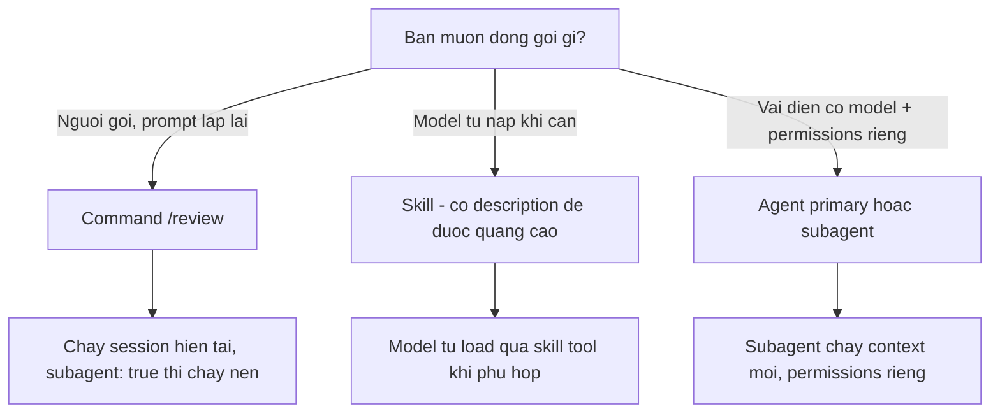

# FAQ 05 — Agents, Commands & Skills

> Tra nhanh khi subagent/skill/command "biến mất" hoặc chạy sai vai. Link chéo: [Bài 05 — Agents](../01-huong-dan-su-dung/05-agents-build-plan-custom.md), [Bài 06 — Commands](../01-huong-dan-su-dung/06-commands-slash-custom.md), [Bài 07 — Skills](../01-huong-dan-su-dung/07-skills.md).
> Nguồn chính thức: [agents](https://opencode.ai/v2/docs/agents) · [skills](https://opencode.ai/v2/docs/skills) · [commands](https://opencode.ai/v2/docs/commands) (verify 28/10/2026, OpenCode 2.2.0).

## Q1: "Subagent không được gọi / skill không hiện?"

**Trả lời 1 câu:** Thiếu `description` (model chọn dựa vào nó) hoặc bị `subagent`/`skill` permissions deny.

**Giải thích:** Subagent được chọn nhờ `description` — OpenCode hiện nó cho model đang quyết định gọi agent nào ([agents — Description](https://opencode.ai/v2/docs/agents), verify 28/10/2026). Skill tương tự: skill **không có `description` sẽ không được advertise** cho model, dù vẫn load được bằng tay ([skills](https://opencode.ai/v2/docs/skills)). Permissions cũng ẩn skill: `deny` = ẩn khỏi model + từ chối load, `ask` = hiện nhưng hỏi trước khi load.

**Làm thế nào:**

1. Subagent: thêm `description` vào frontmatter/JSON — một dòng nói rõ khi nào nên dùng.
2. Skill: thêm `description`; cố ý ẩn khỏi model thì dùng `metadata.opencode/autoinvoke: false` (vẫn gọi tay `@skill-id` được).
3. Check `permissions` có rule deny match ID không; kiểm tra ID trùng (nguồn khai sau thắng).

```yaml
# .opencode/skills/git-release/SKILL.md
---
name: Git Release
description: Prepare release notes, version bumps, and GitHub releases
---
```

**Nếu vẫn lỗi:** skill hiện nhầm nội dung → ID lấy từ **đường dẫn** (`skills/teams/release/SKILL.md` có ID là `release`), case-sensitive, không phải frontmatter `name`; tìm nguồn sau cùng định nghĩa trùng ID.

## Q2: "Đổi agent mà model không đổi?"

**Trả lời 1 câu:** Agent ID và model của session là 2 thứ riêng — đổi model bằng `<leader>m` (Ctrl+X M), agent không tự đổi hộ.

**Giải thích:** "A session stores its selected model separately. Selecting a primary agent by ID does not change that model" ([agents — Model](https://opencode.ai/v2/docs/agents), verify 28/10/2026). Agent chỉ gợi ý model qua field `model` của chính nó (dùng trong command/agent mới). Subagent không set model thì **thừa hưởng model của session cha**. Root `model` trong config hiện chỉ giữ provider+model, không giữ variant — muốn variant thì set ở agent/command hoặc chọn ở session.

**Làm thế nào:**

1. Đổi model của session: `/models` hoặc `Ctrl+X M`.
2. Muốn agent nào model nấy → khai `model` trong agent đó (vd `anthropic/claude-sonnet-5-5#high`).
3. Lệnh chạy riêng một model: `opencode run --model ...`.

**Nếu vẫn lỗi:** subagent dùng nhầm model → nó thừa hưởng model cha khi không có `model`; thêm model vào frontmatter subagent để khóa cứng.

## Q3: "Command vs skill vs agent — dùng cái nào?"

**Trả lời 1 câu:** Việc lặp bạn chủ động gọi → command (`/review`); kiến thức model tự nạp khi cần → skill; vai diễn có model + permissions riêng → agent.



**Giải thích:** Command là prompt template có `$ARGUMENTS`/`$1` và chạy `/name` — đúng lúc bạn quyết định ([commands](https://opencode.ai/v2/docs/commands)). Skill là hướng dẫn model tự nạp khi liên quan, kèm files hỗ trợ ([skills](https://opencode.ai/v2/docs/skills)). Agent là vai diễn ghép system prompt + model + permissions + mode ([agents](https://opencode.ai/v2/docs/agents)). Cả 3 đều verify theo [docs](https://opencode.ai/v2/docs/) 28/10/2026.

**Làm thế nào:** dùng lần 1 → đừng đóng gói; lặp lại ≥2 lần → command; quy trình có tài liệu tham chiếu → skill; vai chuyên biệt (review, plan, audit) → agent.

**Nếu vẫn lỗi:** list `/` quá dài làm model phân tâm và chậm chọn — giữ command cho việc bạn thực sự gọi nhiều, phần còn lại để skill hoặc chỉ dẫn trong AGENTS.md.

## Q4: "Skill tạo rồi mà không hiện trong danh sách?"

**Trả lời 1 câu:** Check 4 thứ theo docs: file phải là `*.md` ở gốc nguồn hoặc `SKILL.md` lồng trong thư mục; ID lấy từ **đường dẫn**; phải có `description`; không bị `autoinvoke: false` hay `skill` deny.

**Giải thích:** Skill ID lấy từ đường dẫn, case-sensitive — `skills/teams/release/SKILL.md` có ID là `release`, dù frontmatter `name` ghi "Git Release" ([skills — IDs](https://opencode.ai/v2/docs/skills), verify 28/10/2026). Nguồn được quét: `~/.config/opencode/skills`, `.opencode/skills`, tương thích với `.claude/skills`, `.agents/skills` — với `SKILL.md` có thể lồng tối đa 6 cấp thư mục. Trùng ID thì **nguồn khai sau** thắng (built-in thấp nhất, project `.opencode/skills` cao, `skills` config cao nhất).

**Làm thế nào:**

1. File ở đúng chỗ? (`skills/review.md` hoặc `skills/<dir>/SKILL.md` — không tìm bên trong thư mục đã chứa SKILL.md.)
2. Có `description` chưa? — thiếu là không được advertise.
3. `metadata.opencode/autoinvoke: false` (hoặc `disable-model-invocation: true`) đúng ý chưa? Khi cả hai set, `opencode/autoinvoke` thắng.
4. Gọi tay được không: nhắc `@<skill-id>` trong prompt — được thì chỉ là vấn đề advertise.

**Nếu vẫn lỗi:** catalog HTTP cần `index.json` hợp lệ, file cùng origin, và tăng `version` khi đổi file — không tăng là bị dùng cache cũ.

## Q5: "Subagent chạy mà không đúng quyền/model của tôi?"

**Trả lời 1 câu:** Subagent dùng permissions và model **của nó**, không phải tập con của cha — chỉ có model là thừa hưởng nếu nó không tự set.

**Giải thích:** "A custom subagent uses its own permissions, not a subset of its parent's permissions" ([permissions — Agents](https://opencode.ai/v2/docs/permissions), verify 28/10/2026). Ai được **gọi** subagent thì do parent's `subagent` permission quyết; subagent chạy với quyền tự khai. Thừa hưởng model cha chỉ khi subagent không khai `model`.

```yaml
# .opencode/agents/reviewer.md
---
description: Reviews changes for correctness and regressions
mode: subagent
model: anthropic/claude-sonnet-5-5#high
permissions:
  - action: edit
    resource: "*"
    effect: deny
---
```

**Nếu vẫn lỗi:** parent không gọi được subagent → check `subagent` permission của parent; muốn chặn subagent gọi tiếp subagent con → `experimental.subagent_depth` (mặc định 1 là chưa cho phép lồng).

## Q6: "Ghi đè built-in agent `build`/`plan` thế nào?"

**Trả lời 1 câu:** Khai agent cùng ID (`build`, `plan`...) trong config — merge theo thứ tự, scalar sau thay trước, permission rules được append.

**Giải thích:** Built-in gồm `build`, `plan`, `general`, `explore` (và 3 agent ẩn `compaction`/`title`/`summary` không chọn trực tiếp được; v2 không có `scout`) ([agents — Builtins](https://opencode.ai/v2/docs/agents), verify 28/10/2026). Agent mới không ghi `mode` mặc định là `primary` — nếu bạn định làm subagent, nhớ set `mode: subagent` tường minh.

**Làm thế nào:**

1. Override hành vi: khai cùng ID trong `agents` config hoặc file `.opencode/agents/<id>.md`.
2. Ẩn khỏi danh sách: `hidden: true` (đây là **điều khiển hiển thị, không phải bảo mật** — chặn thật bằng permissions).
3. Tắt hẳn: `disabled: true` cho built-in hoặc custom.

**Nếu vẫn lỗi:** agent tồn tại nhưng không chọn được → `mode` không phù hợp (subagent không hiện trong picker primary) hoặc `hidden: true`.

## Q7: "Subagent tự chạy vô hạn / muốn giới hạn số bước?"

**Trả lời 1 câu:** Set `steps` (số bước model tối đa) cho agent — hết bước cuối OpenCode gỡ tools và yêu cầu model tự tóm tắt.

**Giải thích:** `steps` là số dương; nhập mới từ user reset lại hạn mức ([agents — Steps](https://opencode.ai/v2/docs/agents), verify 28/10/2026). Còn `mode` quyết định agent chạy ở đâu: `primary` (mặc định cho agent custom mới), `subagent` (chỉ qua child session), `all` (cả hai).

**Làm thế nào:** agent "chân tay lắm lời" → `steps: 8`; agent chỉ dùng qua `subagent` tool → `mode: subagent`; muốn vừa primary vừa subagent → `mode: all`.

**Nếu vẫn lỗi:** agent vẫn dùng quá nhiều bước → steps chỉ chặn số bước model, không chặn độ dài từng bước; kèm chỉ dẫn trong `system` để cắt ngắn vòng lặp.

## Q8: "Sửa file command xong mà `/command` không đổi?"

**Trả lời 1 câu:** Command file và config reload tự động — thường là do trùng tên: nguồn khai **sau** thay thế nguồn trước.

**Giải thích:** Markdown và JSON command dùng chung một registry; project thắng global, project gần hơn thắng project xa; definition custom có thể thay built-in ([commands — Loading](https://opencode.ai/v2/docs/commands), verify 28/10/2026). Command lồng thư mục thành tên có `/` (vd `team/review.md` → `/team/review`).

**Làm thế nào:**

1. Tìm file cùng tên ở `~/.config/opencode/commands/`, project `.opencode/commands/` và các thư mục cha.
2. Chỉnh đúng file đang thắng (project gần nhất).
3. Chỉ `.md` được tự dò; JSON command nằm trong `opencode.jsonc` dưới key `commands`.

**Nếu vẫn lỗi:** command của bạn bị built-in cùng tên che → khai lại trong project với cùng tên để ghi đè, hoặc đổi tên khác.

## Q9: "Agent viết bằng file `.md` hay JSON config?"

**Trả lời 1 câu:** Cả hai — Markdown agent ở `.opencode/agents/<name>.md` (body là system prompt), JSON khai dưới key `agents`; nhưng mỗi file/entry phải thuần một format.

**Giải thích:** Markdown agent: body của file thành prompt `system`, frontmatter nhận cùng fields như JSON entry ([agents](https://opencode.ai/v2/docs/agents), verify 28/10/2026). Đường dẫn lồng nhau thành ID có `/` (vd `team/reviewer.md` → ID `team/reviewer`). File frontmatter dùng V1 fields vẫn được dịch tự động, nhưng mỗi file đọc theo một format duy nhất — file nào có `permissions`/`request`/`system`/`disabled` được đọc là V2, các field V1 trong đó (như `name`, `tools`, `temperature`) bị bỏ qua kèm warning.

**Làm thế nào:**

1. Agent nhanh, nhiều văn → `.md`: body là system prompt, tự nhiên nhất.
2. Sinh từ code/programmatic → JSON `agents` entry (`model` có dạng string hoặc object).
3. File lồng thư mục → ID có `/`; đổi vị trí file là đổi ID.

**Nếu vẫn lỗi:** agent "mất" model/permission sau khi convert → bạn đã trộn V1/V2 fields trong một file; convert nguyên file sang một format duy nhất.

## Q10: "Mở session mặc định bằng agent khác `build`?"

**Trả lời 1 câu:** Set `"default_agent": "<id>"` — agent được chọn phải tồn tại, visible và hỗ trợ primary; session đã chọn agent rồi thì không bị đổi.

**Giải thích:** Setting chỉ áp cho session **mới** chưa chọn agent; đổi setting không thay agent của session đang tồn tại ([agents — Selection](https://opencode.ai/v2/docs/agents), verify 28/10/2026). Nếu default không hợp lệ, OpenCode dùng `build` rồi tới agent visible primary đầu tiên.

```jsonc
{ "default_agent": "writer", "agents": { "writer": { "mode": "primary" } } }
```

**Làm thế nào:**

1. Tạo agent custom với `mode: primary` (hoặc `all`).
2. Khai `default_agent` trỏ tới nó.
3. Session cũ giữ agent cũ — muốn đổi thì đổi trong session (`<leader>a`).

**Nếu vẫn lỗi:** default bị bỏ qua → kiểm tra agent có `hidden: true` hoặc không hỗ trợ primary; cả hai đều khiến fallback về `build`.

## Q11: "Skill đi kèm scripts/files hỗ trợ — chúng load tự động không?"

**Trả lời 1 câu:** Không tự động — skill chỉ gửi cho model biết đường dẫn **mẫu** tối đa 10 file, agent phải tự đọc khi skill hướng dẫn.

**Giải thích:** "Supporting file contents are not loaded automatically. The agent reads them when the skill directs it to do so. The file sample is available for directory-based SKILL.md; flat Markdown skills do not receive a neighboring file list" ([skills — Loading](https://opencode.ai/v2/docs/skills), verify 28/10/2026). Paths trong skill được resolve tương đối từ thư mục chứa `SKILL.md`, không phải từ project. Nên giữ mọi script/reference cần thiết cùng thư mục với `SKILL.md`.

```markdown
!`scripts/changelog.ts`   # duong dan tuong doi tu thu muc SKILL.md
```

**Làm thế nào:**

1. Mỗi skill có thư mục riêng: `skills/git-release/{SKILL.md, scripts/, references/}`.
2. Trong SKILL.md: dùng script/reference bằng đường dẫn tương đối từ thư mục đó.
3. Agent đọc khi skill hướng dẫn — đừng kỳ vọng chúng vào context trước khi được gọi.

**Nếu vẫn lỗi:** agent không thấy file → kiểm tra đường dẫn tương đối từ thư mục skill (không phải project), và nhớ `~`/`$HOME` được expand cho `read`/`edit`/`external_directory` nhưng **không** cho shell resources.
